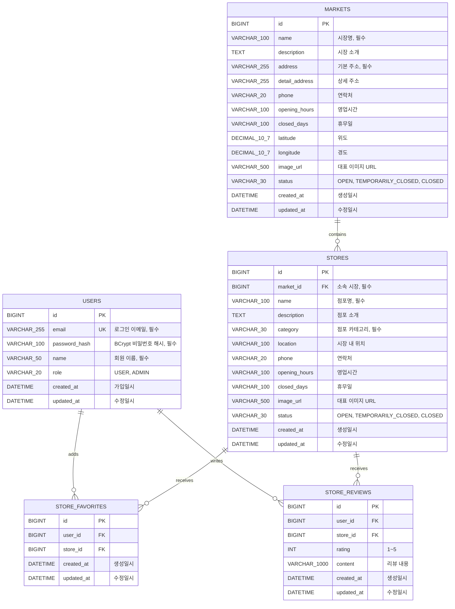

# 전통시장 ERD

현재 운영 스키마는 시장, 점포, 회원, 찜, 리뷰로 구성됩니다. 실제 테이블 생성 기준은 Flyway의 `V1__create_initial_schema.sql`입니다.

## 설계 기준

- 시장명과 기본 주소는 필수 값입니다.
- 좌표는 부동소수점 오차를 피하기 위해 `DECIMAL(10, 7)`로 저장합니다.
- 운영 상태는 문자열 Enum으로 저장하여 DB 값의 의미를 바로 확인할 수 있습니다.
- 시장명과 운영 상태에는 목록 검색을 위한 인덱스를 생성합니다.
- 생성·수정 시간은 Spring Data JPA Auditing으로 자동 기록합니다.
- 점포는 반드시 하나의 시장에 소속되며 `fk_stores_market` 외래키로 무결성을 보장합니다.
- 점포 카테고리는 `AGRICULTURAL`, `FOOD`, `SEAFOOD`, `LIVESTOCK`, `RESTAURANT`, `CLOTHING`, `HOUSEHOLD`, `ETC`로 관리합니다.
- 시장별 점포 조회를 위해 `market_id`와 점포명·카테고리·운영 상태 조합에 인덱스를 생성합니다.
- 회원 이메일은 소문자로 정규화하고 `uk_users_email` 유일 제약으로 중복 가입을 방지합니다.
- 비밀번호 원문은 저장하지 않고 BCrypt 단방향 해시만 `password_hash`에 저장합니다.
- 회원 권한은 기본 `USER`로 생성되며 이후 관리자 기능에서 `ADMIN`을 사용할 수 있습니다.
- 찜과 리뷰는 회원·점포 조합 유일 제약으로 중복 생성을 DB 수준에서도 차단합니다.
- 리뷰 별점은 `1`부터 `5`까지의 값만 허용합니다.
- 운영 DB 구조는 Hibernate 자동 생성이 아니라 Flyway 마이그레이션으로 변경 이력을 관리합니다.
