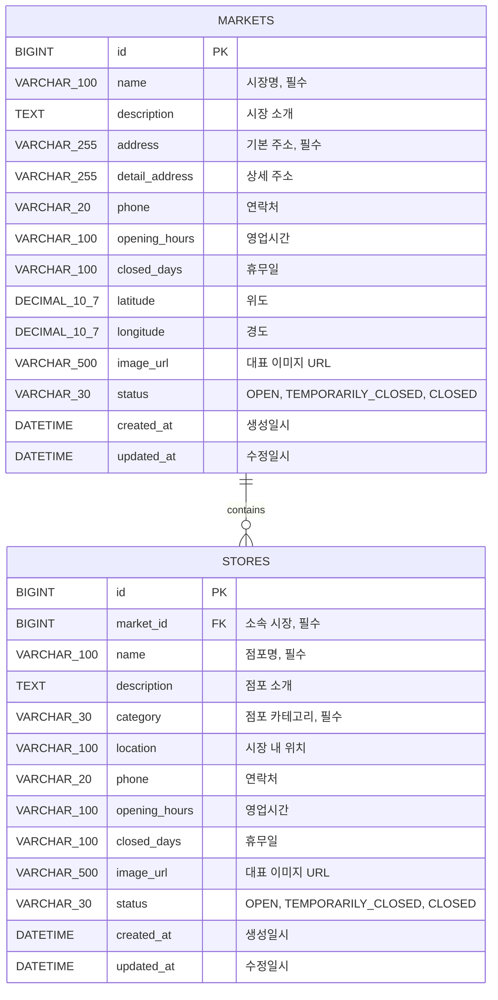

# 전통시장 ERD

`Market`과 `Store`는 시장 하나에 여러 점포가 소속되는 1:N 관계입니다. `stores.market_id` 외래키가 `markets.id`를 참조합니다.

## 설계 기준

- 시장명과 기본 주소는 필수 값입니다.
- 좌표는 부동소수점 오차를 피하기 위해 `DECIMAL(10, 7)`로 저장합니다.
- 운영 상태는 문자열 Enum으로 저장하여 DB 값의 의미를 바로 확인할 수 있습니다.
- 시장명과 운영 상태에는 목록 검색을 위한 인덱스를 생성합니다.
- 생성·수정 시간은 Spring Data JPA Auditing으로 자동 기록합니다.
- 점포는 반드시 하나의 시장에 소속되며 `fk_stores_market` 외래키로 무결성을 보장합니다.
- 점포 카테고리는 `AGRICULTURAL`, `FOOD`, `SEAFOOD`, `LIVESTOCK`, `RESTAURANT`, `CLOTHING`, `HOUSEHOLD`, `ETC`로 관리합니다.
- 시장별 점포 조회를 위해 `market_id`와 점포명·카테고리·운영 상태 조합에 인덱스를 생성합니다.
