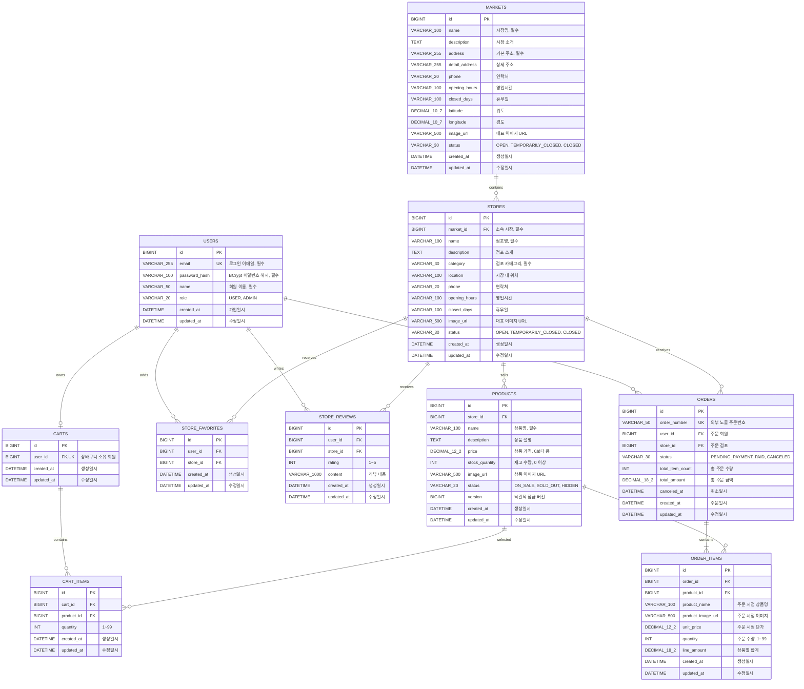

# 전통시장 ERD

현재 운영 스키마는 시장, 점포, 회원, 찜, 리뷰, 상품, 장바구니와 주문으로 구성됩니다. 실제 테이블 생성 기준은 Flyway의 `V1`~`V4` 마이그레이션입니다.

## 설계 기준

- 시장명과 기본 주소는 필수 값입니다.
- 좌표는 부동소수점 오차를 피하기 위해 `DECIMAL(10, 7)`로 저장합니다.
- 운영 상태는 문자열 Enum으로 저장하여 DB 값의 의미를 바로 확인할 수 있습니다.
- 시장명과 운영 상태에는 목록 검색을 위한 인덱스를 생성합니다.
- 생성·수정 시간은 Spring Data JPA Auditing으로 자동 기록합니다.
- 점포는 반드시 하나의 시장에 소속되며 `fk_stores_market` 외래키로 무결성을 보장합니다.
- 점포 카테고리는 `AGRICULTURAL`, `FOOD`, `SEAFOOD`, `LIVESTOCK`, `RESTAURANT`, `CLOTHING`, `HOUSEHOLD`, `ETC`로 관리합니다.
- 시장별 점포 조회를 위해 `market_id`와 점포명·카테고리·운영 상태 조합에 인덱스를 생성합니다.
- 회원 이메일은 소문자로 정규화하고 `uk_users_email` 유일 제약으로 중복 가입을 방지합니다.
- 비밀번호 원문은 저장하지 않고 BCrypt 단방향 해시만 `password_hash`에 저장합니다.
- 회원 권한은 기본 `USER`로 생성되며 이후 관리자 기능에서 `ADMIN`을 사용할 수 있습니다.
- 찜과 리뷰는 회원·점포 조합 유일 제약으로 중복 생성을 DB 수준에서도 차단합니다.
- 리뷰 별점은 `1`부터 `5`까지의 값만 허용합니다.
- 운영 DB 구조는 Hibernate 자동 생성이 아니라 Flyway 마이그레이션으로 변경 이력을 관리합니다.
- 상품은 반드시 하나의 점포에 소속되며 가격은 `DECIMAL(12, 2)`, 재고는 0 이상의 정수로 저장합니다.
- `products.version`은 주문·재고 차감 시 동시 수정을 감지하기 위한 낙관적 잠금 값입니다.
- `HIDDEN` 상품은 공개 상품 목록과 상세 조회에서 제외합니다.
- 회원당 장바구니는 하나만 생성되며 `uk_carts_user` 유일 제약으로 중복 생성을 방지합니다.
- 장바구니 안의 동일 상품은 한 행으로 관리하고 `uk_cart_items_cart_product` 유일 제약으로 중복 행을 방지합니다.
- 장바구니 상품 수량은 1~99개로 제한하며, 서비스 계층에서 현재 상품 재고를 추가로 검증합니다.
- 주문 단위를 명확하게 유지하기 위해 한 장바구니에는 한 점포의 상품만 담을 수 있습니다.
- 주문은 사용자와 점포를 참조하고, 상품명·이미지·단가를 주문 상품에 스냅샷으로 저장하여 이후 상품 정보가 바뀌어도 주문 당시 내역을 유지합니다.
- 주문 생성 시 상품 행을 ID 오름차순으로 비관적 잠금한 뒤 최신 재고를 확인하고 차감하여 동시 주문의 초과 판매를 방지합니다.
- 재고가 0이 되면 상품 상태를 `SOLD_OUT`으로 바꾸고, 결제 대기 주문을 취소해 재고가 복원되면 다시 `ON_SALE`로 전환합니다.
- 현재 주문 생성 상태는 `PENDING_PAYMENT`이며, 결제 전 취소만 허용합니다. `PAID` 전환은 토스페이먼츠 결제 승인 단계에서 연결합니다.
